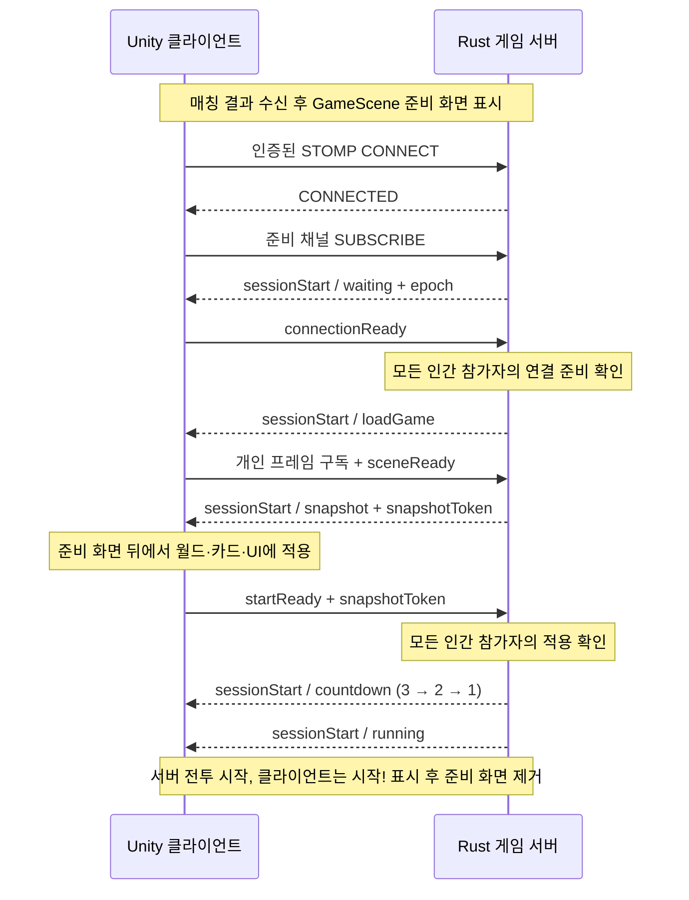

# 매칭 후 게임 연결 및 시작 프로토콜

`startProtocolVersion: 1`에서는 게임 서버가 모든 인간 참가자의 초기 상태 적용을 확인한 뒤 카운트다운을 시작한다. 매칭 결과를 받은 Unity 클라이언트는 바로 GameScene을 열고 준비 화면 뒤에서 접속과 상태 적용을 진행한다.

## HTTP로 시작 버전 협상

1. Unity는 매칭 요청에 `X-Game-Start-Protocol: 1`을 보낸다. 로비는 매칭 티켓과 친선전 초대에 지원 여부를 보관한다. 인간 참가자 모두가 지원하면 버전 1을 사용한다. 봇은 준비 응답 대상에서 제외하며, 연습·모험은 인간 한 명의 지원 여부를 확인한다.
2. 로비는 서버 권한으로 `GET /api/server/game-sessions/start-protocol`을 호출해 선택한 게임 서버의 버전을 확인한다. 지원이 확인되면 `POST /api/server/game-sessions`에 `startProtocolVersion: 1`을 넣고 응답의 `attemptId`, `sessionId`, `ready`, 버전을 대조한다.
3. 생성 응답의 `ready: true`는 대기 세션에 연결할 수 있다는 뜻이다. 로비는 게임 서버 접속 주소와 협상한 버전을 매칭 결과와 복구 정보에 보존한다.

구버전 또는 혼합 클라이언트는 기존 시작 흐름을 사용한다. local·debug·bot-only 세션도 기존 흐름을 유지한다. 버전 1을 요청한 로비는 해당 버전을 지원하지 않는 서버에 생성 요청을 보내지 않는다. 배포 순서는 Rust 서버 → 로비 → Unity 클라이언트다.

## WebSocket에서 준비와 시작



위 흐름은 참가자 한 명의 메시지를 보여준다. 개인 프레임 구독은 `sceneReady` 전에 마쳐야 한다. `loadGame`은 서버가 씬 준비 완료를 받을 수 있는 상태라는 뜻이다.

| 방향 | STOMP 명령 | 목적지 |
| --- | --- | --- |
| Unity → 게임 서버 | `SUBSCRIBE` | `/game/{sessionId}/start/{userId}` |
| Unity → 게임 서버 | `SUBSCRIBE` | `/game/{sessionId}/frameInfos/{userId}` |
| Unity → 게임 서버 | `SEND` | `/app/game/start/{sessionId}/{userId}` |

클라이언트는 모든 준비 요청에 준비 채널에서 받은 `epoch`를 넣는다. `startReady`에는 적용한 snapshot의 `snapshotToken`도 넣는다. `cancel`은 경기 시작 전 취소 요청이다.

```json
{
  "type": "startReady",
  "epoch": "connection-example",
  "snapshotToken": "snapshot-example"
}
```

서버 메시지는 `type: "sessionStart"`, `version: 1`, `phase`, `epoch`를 담는다. `phase: "snapshot"`일 때 `snapshot`은 해당 참가자의 `sync` DTO이며 `snapshotToken`이 함께 온다. 클라이언트는 적용에 성공한 경우에만 ACK를 보낸다. `countdown`은 `phase: "countdown"`에서 3·2·1의 값을 표시할 때 사용한다. `phase: "cancelled"`에는 `reason`이 들어간다.

## 재시도와 종료

- 서버는 인증된 참가자와 현재 연결에 준비 상태를 귀속한다. Unity는 준비 요청을 반복할 수 있고, 서버는 ACK가 올 때까지 같은 snapshot과 토큰을 재전송한다.
- 연결 종료나 준비에 필요한 구독 해제는 해당 연결의 준비 상태를 무효화한다. 이전 연결의 ACK나 늦은 종료 이벤트는 새 연결에 적용되지 않는다. 카운트다운 중 연결이 끊기면 다시 준비 확인을 거쳐 3부터 센다.
- 이미 진행 중인 경기에서는 새 연결로 준비 채널과 개인 프레임을 다시 구독하고 새 snapshot을 적용한다. 경기는 계속 진행되며 카운트다운을 다시 하지 않는다. 모험 상태는 시작 또는 재접속 완료 후 기존 `pveSync`로 복구한다.
- 준비와 카운트다운 중에는 경기 시간·마나·카드·AI·물리 처리를 멈춘다. 서버는 준비 시간 초과나 시작 전 취소를 `Abandoned`로 정리하고 승패·MMR을 갱신하지 않는다.

| 기준 | 시간 | 동작 |
| --- | --- | --- |
| 서버 준비 제한 | 180초 | 대기 세션 생성 기준. 재접속으로 연장하지 않는다. |
| Unity 연결 시도 | 20초 | 시도 하나에 주는 시간이다. |
| 경기 프레임 무응답 | 5초 | Unity가 재연결을 시도한다. 준비 중인 세션에는 적용하지 않는다. |
| 경기 중 복구 | 30초 | Unity가 연결 복구를 기다린다. |
| 서버 ping 미응답 | 30초 | 경기 중 봇 대체 판단에 사용한다. |
| 로비 복구 정보 보존 | 30분 | 복구 요청 시 게임 서버에서 세션 활성 여부를 확인한다. |

구현은 [Rust 서버 PR #51](https://github.com/Apptive-Game-Team/ArcaneCastersGameRust/pull/51), [로비 PR #128](https://github.com/Apptive-Game-Team/ArcaneCastersLobby/pull/128), [Unity 클라이언트 PR #468](https://github.com/Apptive-Game-Team/ArcaneCastersClient/pull/468)에 있다.
